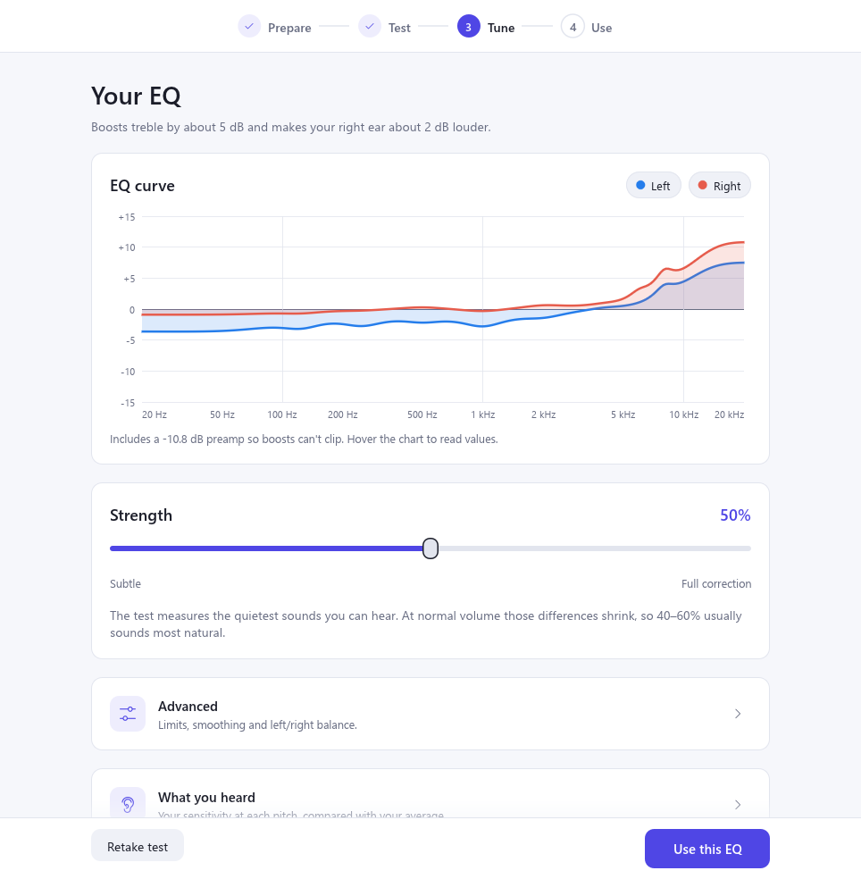
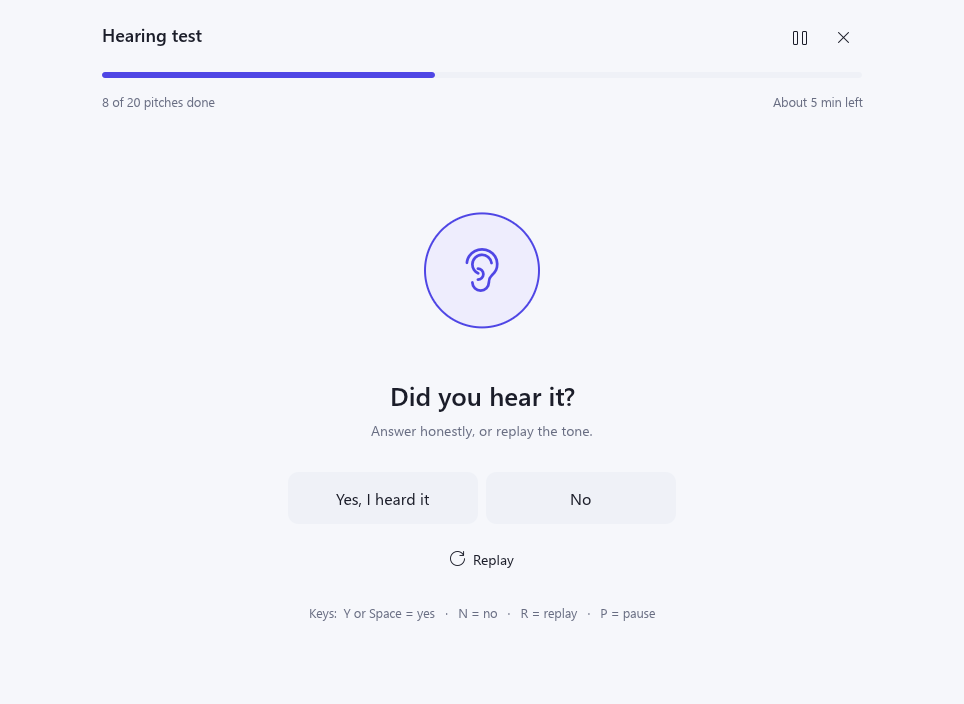
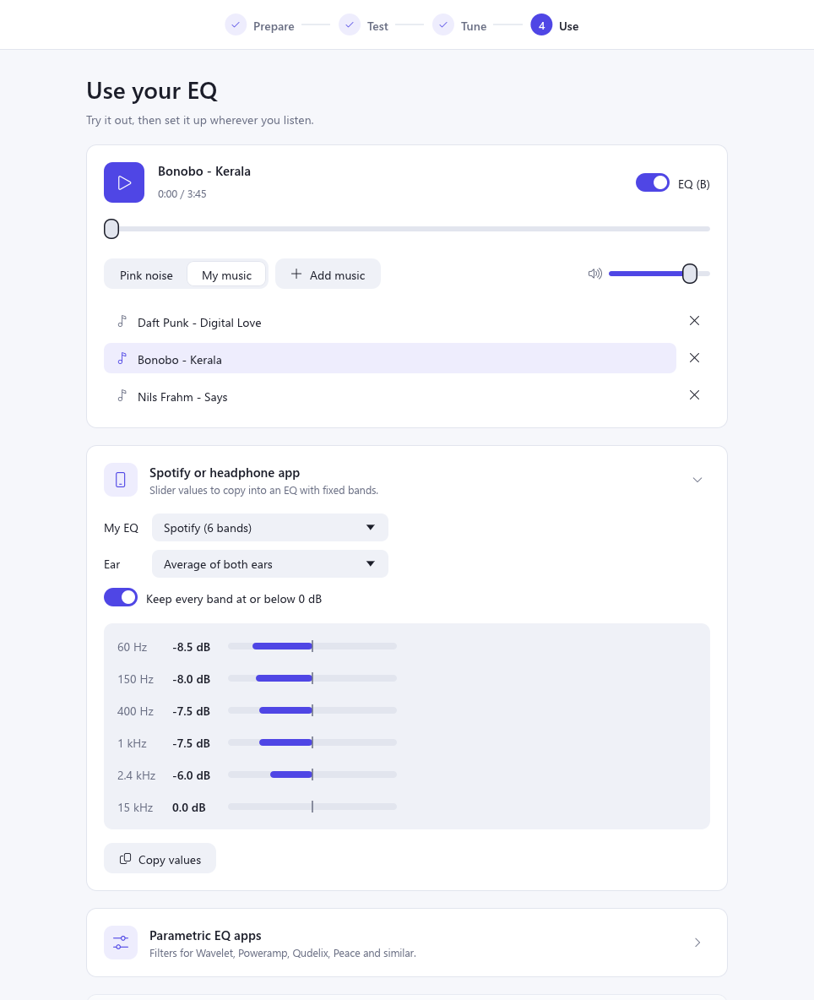

# Earmark

An EQ earmarked for your ears.

A Windows desktop app (Rust + egui) that builds a personal headphone EQ from a short hearing test,
then lets you hear it on your own music and copy it into the EQ you already use.

<picture>
  <source media="(prefers-color-scheme: dark)" srcset="docs/screenshots/tune-dark.png">
  
</picture>

To install, download `Earmark-<version>-windows-x64.zip` from the
[latest release](https://github.com/josephmurrells/earmark/releases/latest), extract it anywhere and
run `earmark.exe`. It needs 64-bit Windows 11 and nothing else; Windows 10 should work but hasn't
been tested. It isn't code-signed yet, so SmartScreen may warn about an "unknown publisher" the
first time you run it.

## How it works

1. **Prepare**: set a comfortable volume with a 1 kHz tone that plays only while you hold the
   button, check left and right, and choose the test: one ear at a time (a separate EQ for each
   ear) or both ears together (half the time).
2. **Test**: short beeps at different pitches. Answer *heard* / *not heard*, replay a tone (R), or
   go back to change earlier answers (B), including the last one before the results show.
   Each pitch and ear runs its own Hughson-Westlake-style staircase (down 10 dB when heard, up 5 dB
   when missed; the threshold is two hits on the way up within 5 dB of each other). Three pitches
   run at a time in random order with random gaps, so they finish steadily; a progress bar and a
   time-left estimate based on your own pace show how far through you are. Silent checks flag
   guessing. Once some pitches are measured, each new one starts 5 dB above the level predicted
   from those already done. The results include a just-for-fun hearing score out of 100, based on
   how evenly you hear across pitches and between your ears, so it compares fairly across
   headphones and volumes.

   <picture>
     <source media="(prefers-color-scheme: dark)" srcset="docs/screenshots/test-dark.png">
     
   </picture>

3. **Tune**: thresholds minus the ISO 226 normal-hearing curve give what's specific to you and
   your headphones. The median is removed, the result is scaled by *strength* and limited by max
   boost and cut, then fitted with low-shelf, peak and high-shelf filters, with a preamp so nothing
   clips.
4. **Use**: A/B the EQ at matched levels on pink noise or your own music (MP3, FLAC, M4A/AAC, OGG
   or WAV; add files or drag them onto the window). Then copy it into the EQ you already use:
   slider values for Spotify, Sony Headphones Connect, a 10-band graphic EQ or your own band
   frequencies, a filter table for parametric EQ apps, or export files (a per-ear config, and
   AutoEQ-style `ParametricEQ.txt` / `GraphicEQ.txt`).

   <picture>
     <source media="(prefers-color-scheme: dark)" srcset="docs/screenshots/use-dark.png">
     
   </picture>

## Not a medical test

Earmark tunes how your headphones sound to you. It is not a medical device or a clinical hearing
test, and it can't diagnose hearing loss. Levels aren't calibrated in dB HL, and results depend on
your headphones, their fit and the room. If you've noticed a change in your hearing, or one ear is
much weaker than the other, see a doctor or audiologist.

## How the EQ is made

The test measures your ears *and* your headphones together, at the quietest audible level. That's
why the EQ is applied at partial strength: differences shrink at normal listening volume.

## Files

- Settings and results: `%APPDATA%\Earmark\data\app.ron`.
- Crash reports: `%APPDATA%\Earmark\data\crash.log`. If Earmark crashes it says where the report
  is; please include it with any bug report.

## Building

Needs Rust 1.95 or newer and the MSVC build tools (the Windows SDK's `rc.exe` embeds the icon and
version info). The C runtime is linked statically, so `earmark.exe` runs without the Visual C++
Redistributable.

```sh
cargo run --release
cargo test
cargo test screenshots -- --ignored   # renders every screen, light and dark, to %TEMP%\earmark-*.png
cargo test write_ico -- --ignored     # regenerates assets/earmark.ico after changing the icon
```

## Releasing

CI (`.github/workflows/ci.yml`) checks formatting, clippy and tests on every push and pull request.
To release, bump `version` in `Cargo.toml` on master, then push a matching tag, such as `v0.1.0`.
The release workflow tests and builds it, packages
`Earmark-<version>-windows-x64.zip` with `release/package.ps1`, and opens a draft release with the
zip and `SHA256SUMS.txt`. Check the draft, then publish it.

`release/package.ps1` can also be run locally after `cargo build --release --locked` (it needs
`cargo-about`): `./release/package.ps1 -Version 0.1.0` writes to `dist/`.

## Licence

Earmark is licensed under either of [Apache License 2.0](LICENSE-APACHE) or [MIT](LICENSE-MIT), at
your option.

It's built on open-source crates under their own licences. Release zips include all of them in
`THIRD-PARTY-LICENSES.txt` and the `licenses` folder, generated from `release/about.toml`; include
those files when distributing `earmark.exe`. Audio decoding uses [Symphonia](https://github.com/pdeljanov/Symphonia), unmodified,
under the Mozilla Public License 2.0; its source is available from that repository and crates.io.
Earmark uses the Segoe UI fonts and Segoe Fluent Icons installed with Windows at runtime and doesn't
include them.

Earmark comes with no warranty: see the licences for details. Keep the volume comfortable during
the test and when trying the EQ, as boosts make some sounds louder.

Earmark isn't affiliated with or endorsed by Spotify, Sony, Microsoft or the makers of the other
apps and devices named here. Product names are trademarks of their owners.

## Contributing

Bug reports, ideas and pull requests are welcome: see [CONTRIBUTING.md](CONTRIBUTING.md). Please
report security problems privately, as described in [SECURITY.md](SECURITY.md).
